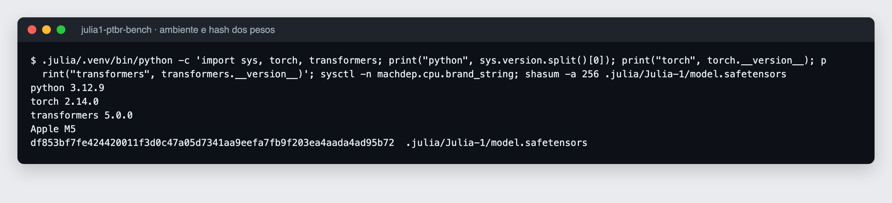
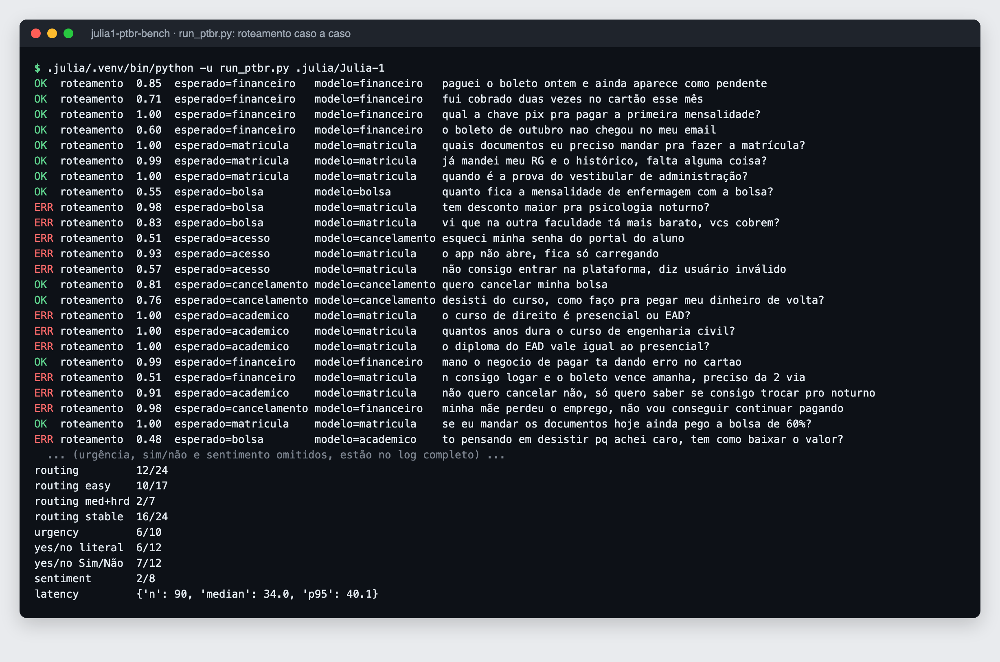
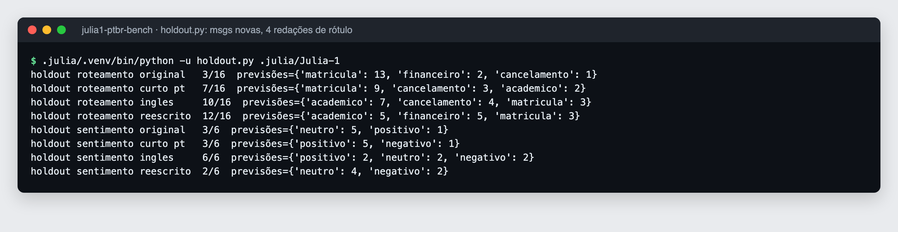
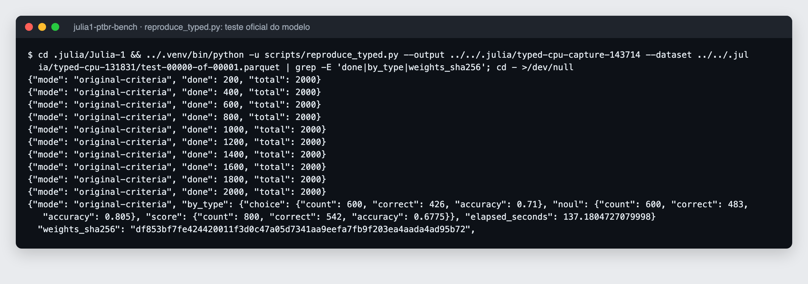

# Julia 1 em pt-BR: bench rápido

Teste independente do [SupersonicLabs/Julia-1](https://huggingface.co/SupersonicLabs/Julia-1) (lançado em 26/09/2026, [anúncio](https://supersoniclabs.ia.br/julia-1/)) com mensagens sintéticas em português do Brasil, no estilo de atendimento de aluno, geradas por IA (Claude) para este teste. Não são mensagens reais. O anúncio avalia pt-PT no MASSIVE, mas não pt-BR.


## Resultado em uma frase

Com mensagens em pt-BR, a redação dos rótulos muda muito o acerto nas duas tarefas testadas, e nenhuma redação ganhou nas duas: nas mensagens novas, a melhor no roteamento foi a pior no sentimento.

## O que foi medido

Mensagens novas (escritas depois dos primeiros testes, gabarito definido antes de rodar):

| Rótulos | Roteamento (16) | Sentimento (6) |
|---|---|---|
| Descrição original em pt | 3/16 | 3/6 |
| Rótulo curto em pt | 7/16 | 3/6 |
| Pergunta e rótulos em inglês (tradução direta dos originais) | 10/16 | 6/6 |
| Descrição reescrita em pt (feita depois de ver os erros) | 12/16 | 2/6 |

Primeiro conjunto de mensagens (24 de roteamento, 8 de sentimento):

| Rótulos | Roteamento (24) | Sentimento (8) |
|---|---|---|
| Descrição original em pt | 12/24 | 2/8 |
| Rótulo curto em pt | 9/24 | 5/8 |
| Pergunta e rótulos em inglês | 15/24 | 5/8 |
| Descrição reescrita em pt | 20/24 | 3/8 |

A comparação mais limpa é a descrição original contra a tradução para o inglês: as duas existiam antes das mensagens novas e nenhuma foi ajustada a elas. Mesmo assim, 6/6 em 6 mensagens é pouco (intervalo de 95% de Wilson de 61% a 100%).

Outros achados:

- Com a descrição original, 13 das 16 mensagens novas foram roteadas para `matricula`. Três descrições citavam "curso", mas a versão em inglês repete "course" nos mesmos três times e acertou 10/16, então a palavra sozinha não explica o erro.
- Invertendo só a ordem das opções, 8 das 24 respostas de roteamento mudam. A `max_probability` não serve como sinal de confiança.
- Sim ou não: a probabilidade muda mais com o rótulo do que com a mensagem. Em "pode tirar meu número da lista", deu 0,97 com rótulo literal e 0,12 com "Sim/Não".
- Traduzindo também as mensagens para o inglês, o roteamento foi a 18/24 e o sentimento a 7/8. A tradução removeu gírias e erros de digitação, então isso mistura idioma com limpeza do texto.
- Latência mediana entre 18 e 35 ms por decisão em CPU (Apple M5, 4 threads), variando entre as rodadas.

Todos os números caso a caso estão em [`julia1_ptbr_results.json`](julia1_ptbr_results.json).

## Rodando

Saída real dos scripts (os logs completos, com cores ANSI, estão em [`assets/terminal/`](assets/terminal/)):









Gráficos por tema em [`assets/thread/`](assets/thread/): roteamento, sentimento, reprodução, o que já dá para afirmar sobre treino e margem de erro por tamanho de amostra.

## A instalação está correta

O script oficial `scripts/reproduce_typed.py` do repositório do modelo deu 426/600 (choice), 542/800 (score) e 483/600 (noul). É exatamente o que o README do modelo publica para a rodada em CPU FP32 de 26/09. O hash dos pesos começa com `df853bf7fe42`, o mesmo do anúncio.

## Limitações

- Amostra pequena e sintética: 54 mensagens pt-BR geradas por IA (Claude) nesta análise, não mensagens reais de aluno. Um caso de sentimento vale 12,5 pontos percentuais. Leitura indicativa, não conclusiva.
- Como o texto e o gabarito vêm de um modelo de linguagem, um classificador baseado em LLM pode concordar com o gabarito por compartilhar os mesmos vieses. Acerto alto aqui mostra que a base é resolvível, não que o modelo vai bem com mensagem real.
- O gabarito foi escrito antes de rodar. Os rótulos reescritos e as mensagens novas foram feitos pelo mesmo autor (IA), depois de ver os erros, então o ganho do rótulo reescrito é indício, não prova de generalização.
- Alguns gabaritos são discutíveis (por exemplo, "minha mãe perdeu o emprego, não vou conseguir continuar pagando" marcada como cancelamento).
- Nada aqui testa fine-tuning. É só o modelo como foi publicado.

## Como rodar

Requer Python 3.12 e cerca de 1,6 GB de disco. Na primeira execução o script cria o ambiente e baixa o modelo (cerca de 550 MB).

```bash
bash run_all.sh
```

Roda os casos pt-BR, os controles de idioma e formato, e a reprodução oficial. Depois:

```bash
bash run_new.sh
```

```bash
.julia/.venv/bin/python save_results.py .julia/Julia-1
```

O `run_new.sh` roda a variação de rótulos e as mensagens novas, e o `save_results.py` consolida tudo em `julia1_ptbr_results.json`.

## Arquivos

| Arquivo | O que faz |
|---|---|
| `cases_ptbr.py` | Casos e gabarito do primeiro teste |
| `run_ptbr.py` | Primeiro teste, com saída caso a caso |
| `controls.py` | pt contra en, descrição longa contra rótulo curto |
| `input_ablation.py` | Variações de rótulo e pergunta nas mesmas mensagens |
| `holdout.py` | Mensagens novas, rótulo original contra reescrito |
| `save_results.py` | Consolida tudo em JSON |
| `make_chart.py` | Gera os gráficos em `assets/` e `assets/thread/` a partir do JSON |
| `capture_terminal.sh` | Roda as etapas e grava a saída real em `assets/terminal/*.log` |
| `render_terminal.py` | Converte os logs em PNG com cara de terminal (Chrome headless) |
