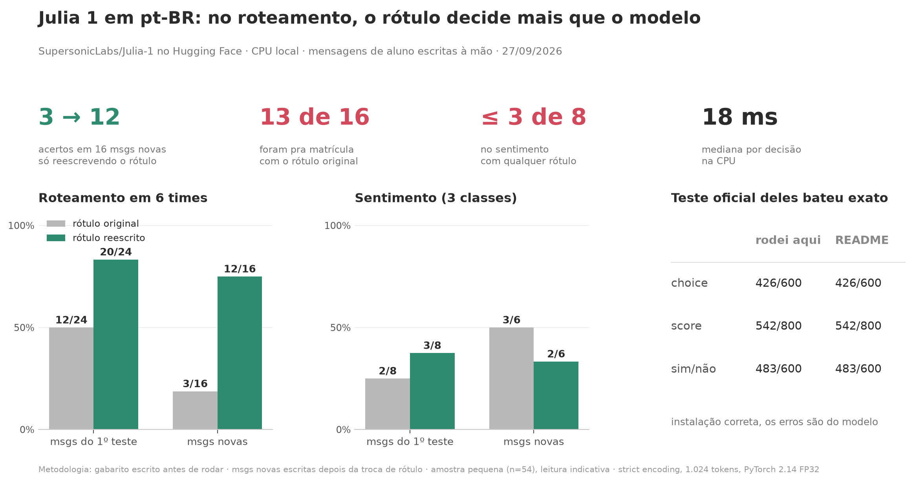

# Julia 1 em pt-BR: bench rápido

Teste independente do [SupersonicLabs/Julia-1](https://huggingface.co/SupersonicLabs/Julia-1) (lançado em 26/09/2026, [anúncio](https://supersoniclabs.ia.br/julia-1/)) com mensagens de atendimento de aluno em português do Brasil. O anúncio avalia pt-PT no MASSIVE, mas não pt-BR.



## Resultado em uma frase

No roteamento, a redação do rótulo pesa mais que o modelo: com os rótulos originais ele acertou 3 de 16 mensagens novas, com rótulos reescritos acertou 12 de 16. No sentimento, nenhuma redação de rótulo passou de 3 acertos em 8.

## O que foi medido

| Teste | Rótulo original | Rótulo reescrito |
|---|---|---|
| Roteamento em 6 times, 24 mensagens | 12/24 | 20/24 |
| Roteamento, 16 mensagens novas | 3/16 | 12/16 |
| Sentimento (3 classes), 8 mensagens | 2/8 | 3/8 |
| Sentimento, 6 mensagens novas | 3/6 | 2/6 |

Outros achados, todos com os rótulos originais:

- Com os rótulos originais, 13 das 16 mensagens novas foram roteadas para `matricula`. Duas descrições de time citavam "curso", e o modelo casou a palavra.
- Invertendo só a ordem das opções, 8 das 24 respostas de roteamento mudam. A `max_probability` não serve como sinal de confiança.
- Sim ou não: a probabilidade muda mais com o rótulo do que com a mensagem. Em "pode tirar meu número da lista", deu 0,97 com rótulo literal e 0,12 com "Sim/Não".
- Traduzindo as mensagens para o inglês, o roteamento subiu de 12/24 para 18/24 e o sentimento de 2/8 para 7/8. A tradução também removeu gírias e erros de digitação, então essa comparação mistura idioma com limpeza do texto.
- Latência mediana entre 18 e 35 ms por decisão em CPU (Apple M5, 4 threads), variando entre as rodadas.

Todos os números caso a caso estão em [`julia1_ptbr_results.json`](julia1_ptbr_results.json).

## A instalação está correta

O script oficial `scripts/reproduce_typed.py` do repositório do modelo deu 426/600 (choice), 542/800 (score) e 483/600 (noul). É exatamente o que o README do modelo publica para a rodada em CPU FP32 de 26/09. O hash dos pesos começa com `df853bf7fe42`, o mesmo do anúncio.

## Limitações

- Amostra pequena: 54 mensagens pt-BR, escritas à mão. Um caso de sentimento vale 12,5 pontos percentuais. Leitura indicativa, não conclusiva.
- O gabarito foi escrito antes de rodar. Os rótulos reescritos foram feitos depois de ver os erros, e as 16 mensagens novas foram escritas depois da troca, para medir se o ganho generaliza.
- Alguns gabaritos são discutíveis (por exemplo, "minha mãe perdeu o emprego, não vou conseguir continuar pagando" marcada como cancelamento).
- Nada aqui testa fine-tuning. É só o modelo como foi publicado.

## Como rodar

Requer Python 3.12 e cerca de 1,6 GB de disco. Na primeira execução o script cria o ambiente e baixa o modelo (cerca de 550 MB).

```bash
bash run_all.sh
```

Roda os casos pt-BR, os controles de idioma e formato, e a reprodução oficial. Depois:

```bash
bash run_new.sh
```

```bash
.julia/.venv/bin/python save_results.py .julia/Julia-1
```

O `run_new.sh` roda a variação de rótulos e as mensagens novas, e o `save_results.py` consolida tudo em `julia1_ptbr_results.json`.

## Arquivos

| Arquivo | O que faz |
|---|---|
| `cases_ptbr.py` | Casos e gabarito do primeiro teste |
| `run_ptbr.py` | Primeiro teste, com saída caso a caso |
| `controls.py` | pt contra en, descrição longa contra rótulo curto |
| `input_ablation.py` | Variações de rótulo e pergunta nas mesmas mensagens |
| `holdout.py` | Mensagens novas, rótulo original contra reescrito |
| `save_results.py` | Consolida tudo em JSON |
| `make_chart.py` | Gera a imagem em `assets/` |
